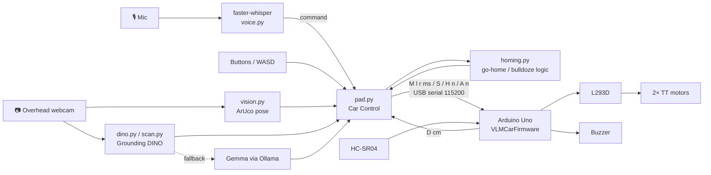

My AI agent compiled all the materials and put this on Github:

# VLM Car 

A small Arduino robot car you drive by **talking to it**. A webcam mounted over my table watches the table, finds the car by an ArUco marker on its roof, finds objects by name with an open-vocabulary detector, and a Mac app turns commands like *"lighter, bulldoze"* or *"go home"* into motor commands over USB serial.

## Features

- **Car Control window** (`pad.py`): live camera view with overlays, clickable on-screen buttons, and **WASD** driving (hold to drive, space to stop, `+`/`-` speed, `[`/`]` heading trim, `q`/Esc to quit).
- **Voice control**: local speech-to-text with **faster-whisper `base.en`**; `voice.py` parses the phrases into actions.
- **Find objects by name**: **Grounding DINO tiny** (`dino.py`, `scan.py`), with **Gemma via Ollama** as a fallback for things DINO misses.
- **Bulldoze**: aims at the target, approaches with both wheels driving, then locks the target and rams it when close (or when the car itself covers it in the image).
- **Go home**: reverse arc turns until the car's rear points at the home spot (78% / 75% of frame), then backs straight in. If the marker is off-screen, it retraces its recent moves backwards.
- **Edge guard**: if a move would push the marker within 8% of the frame edge, the car backs away instead.
- **Moods**: praise → happy chirp, insults → sad beep.
- Ultrasonic distance (HC-SR04) reported by the firmware.

## How it works



## Hardware / BOM

| Qty | Part |
|---|---|
| 1 | Arduino Uno + USB cable |
| 1 | L293D motor driver IC + breadboard |
| 2 | TT gear motors with wheels (optional printed TPU tires, `hardware/tires/`) |
| 1 | Rear caster (printed mount/pivot in `hardware/chassis/`, or a ball caster) |
| 1 | Passive/active buzzer |
| 1 | HC-SR04 ultrasonic sensor |
| 1 | 4–6 × AA battery pack with barrel plug (9 V works but drains fast) |
| 1 | Logitech USB webcam mounted overhead, looking down at the table |
| 1 | ArUco marker DICT_4X4_50 id 0 (printed, `hardware/marker/`) |
| — | Jumper wires, chassis plate |

## Wiring

| From | To |
|---|---|
| L293D 1 (left enable) | D5 |
| L293D 9 (right enable) | D6 |
| L293D 2 / 7 (left inputs) | D3 / D4 |
| L293D 10 / 15 (right inputs) | D7 / D8 |
| L293D 3 / 6 | Left motor |
| L293D 11 / 14 | Right motor |
| L293D 16 (logic) | 5V |
| L293D 8 (motor power) | VIN (battery in barrel jack) or 5V |
| L293D 4, 5, 12, 13 | GND |
| Buzzer + / − | D10 / GND |
| HC-SR04 Trig / Echo | D12 / D11 |

Full details in [docs/wiring.md](docs/wiring.md).

## Setup & run

1. **Firmware**: open `firmware/VLMCarFirmware/VLMCarFirmware.ino` in the Arduino IDE, select Arduino Uno, upload.
2. **Marker**: print the marker (`hardware/marker/`) and stick it on top of the car, top edge facing the front.
3. **Camera**: mount the webcam overhead looking down. The app uses camera index 0.
4. **Python** (macOS, Apple Silicon recommended — torch uses MPS):
   ```bash
   cd software
   python3 -m venv .venv
   .venv/bin/pip install -r requirements.txt
   ```
5. **Optional fallback**: install [Ollama](https://ollama.com) and `ollama pull gemma3:4b` (used at `http://localhost:11434`).
6. **Run**: plug in the Arduino over USB, then double-click `software/Start Car Control.command` (or `cd software && .venv/bin/python pad.py`).
   The serial port is auto-detected (`/dev/cu.usbmodem*` / `/dev/cu.usbserial*`).

The first run downloads the Whisper and Grounding DINO weights from Hugging Face (they are not stored in this repo). macOS will ask for camera and microphone permission.

### Notes on paths

- `pad.py` saves the heading trim (`[` / `]` keys) to `software/heading_trim.json` next to itself. It's created automatically and git-ignored.
- The original launcher pointed at a venv outside the project (`../RadarScreen/.venv`); in this repo it uses `software/.venv` instead. No other external paths are used.

## Voice commands

Examples (see `voice.py` for the full parser):

| Say | Does |
|---|---|
| "lighter, bulldoze" / "mouse, ram" / "cube, charge" | Find the object and ram it (also: push, smash, attack, crash) |
| "can, follow" | Target / follow an object |
| "scan" / "look around" | Build an object map of the table |
| "go home" / "come back" / "return" | Back into the home spot |
| "stop" / "halt" / "whoa" / "enough" | Stop |
| Praise ("good job", "nice", "well done", …) | Happy chirp |
| Insults ("bad robot", "stupid", "you suck", …) | Sad beep |

Unknown object names go to Gemma (via Ollama) to locate.

## Serial protocol

115200 baud, one command per line:

| Command | Meaning |
|---|---|
| `M l r ms` | Drive left/right wheels at speed `l`, `r` (−255…255) for `ms` milliseconds |
| `S` | Stop |
| `H n` | Happy chirp variant `n` |
| `A n` | Sad beep variant `n` |

The board prints `READY` on boot and `D <cm>` (ultrasonic distance) about every 200 ms.

## File guide

```
software/
  pad.py          Car Control app: window, buttons, WASD, bulldoze, go-home, edge guard
  vision.py       ArUco car pose (with mirrored fallback), color targets, heading trim
  voice.py        Mic + faster-whisper, phrase parsing, Ollama/Gemma bbox fallback
  dino.py         Grounding DINO tiny object finder
  scan.py         Object map / region proposals labeled by Gemma
  homing.py       Go-home helpers
  requirements.txt
  Start Car Control.command   macOS double-click launcher
firmware/VLMCarFirmware/VLMCarFirmware.ino
hardware/marker/  ArUco marker generator, STLs, preview
hardware/tires/   TPU tire 65×25
hardware/chassis/ axle, wheel, caster mount/pivot STLs
docs/wiring.md
```

## Ideas & limitations

- macOS-focused (serial port globs, `.command` launcher, MPS). Linux/Windows would need small tweaks.
- Needs decent, even lighting; glare on the marker breaks tracking.
- Pose is 2D from a single overhead camera — the camera must stay put.
- Open-loop timed moves: battery level changes how far a move goes.
- Ideas: use the HC-SR04 for obstacle stops, wheel encoders, a wireless link (HC-05/ESP32), multi-car with more marker ids.

## License

MIT — see [LICENSE](LICENSE).
